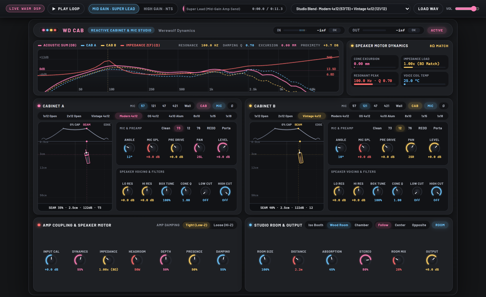

# Werewolf Dynamics — WD Cab (v0.2.1)

A guitar and bass speaker cabinet simulated as a coupled electromechanical system, not a static impulse response — free **VST3** and **CLAP** for Windows 64-bit, plus a full **live WebAssembly browser demo**.

An impulse response is a photograph of a speaker taken at one signal level. A real cabinet is a motor fighting an amplifier: palm mutes stretch the spider and push the cone's resonant frequency upward mid-chug, the moving impedance curve loads down the amplifier's negative-feedback loop, voice coils heat up and dynamically compress, and paper cones break up radially when pushed hard. **WD Cab** solves that coupled loop in real time while your amp signal runs through it.

- **[Launch Live WebAssembly Browser Demo](https://xbombjackx.github.io/wd-cab-releases/)** — runs the exact C++20 DSP engine directly in your browser (WebAudio + WebAssembly, zero server uploads)
- **[GitHub Releases](https://github.com/xBombjackx/wd-cab-releases/releases)** — Windows 64-bit VST3 & CLAP archives + offline HTML5 demo bundle
- **[Itch.io Page](https://xbombjackx.itch.io/wd-cab)** — playable embed, screenshot, and direct download mirror

## Try It Live in Your Browser

Open **[https://xbombjackx.github.io/wd-cab-releases/](https://xbombjackx.github.io/wd-cab-releases/)** to audition **WD Cab** immediately without installing anything:

- Switch seamlessly between a mid-gain **Super Lead** and high-gain **NTS** amp send (or drag-and-drop your own raw preamp / power-amp WAV stem) while keeping exact riff timing.
- Audition all 12 built-in rig presets, drag dual virtual microphones across the 2D speaker grille, watch the live impedance *Z(f)* curve, resonant *F_s(x)* shift, and millimeter cone excursion react in real time, or drop custom `.wav` cabinet IRs directly onto **Cab A** or **Cab B**.

## What's Inside

- **Coupled Speaker Motor & Impedance Matching:** 5-state nonlinear RK4 speaker motor tracking cone excursion *x(t)*, voice-coil thermal rise, Tight / Loose source-impedance coupling, and 4Ω / 8Ω / 16Ω Z-Match loading.
- **Dual Procedural Cabinets + Custom `.wav` IR Loader (`Cab A` + `Cab B`):** Thirteen enclosures (`1x10 Tweed`, `1x12 Open`, `1x12 Ported`, `2x12 Open`, `2x12 Alnico`, `Vintage 4x12`, `Modern 4x12`, `Oversized Modern 4x12`, `4x12 Brit 75`, `4x10 Aluminum`, `8x10`, `1x15`, and `1x18`) shaped with enclosure-specific modal contours and baffle reflections, continuous `Box Scale`, `Cone Damping`, `Lo Res` / `Hi Res` trims, `HPF` / `LPF`, pan, and level — or browse/drag-and-drop your own `.wav` IR onto either cabinet slot downstream of the live motor and upstream of the analog console preamps.
- **2D Virtual Microphones & Analog Preamp Suite:** Eight microphone voicings (`57`, `121`, `160`, `47`, `414`, `421`, `906`, `Wall`) with continuous radial cone position, grille distance (`0.5 cm` – `50 cm`), off-axis angle, capsule SPL overload, Fresnel phase alignment for comb-free multi-miking, polarity invert (`Ø`), and six circuit-modeled mic preamps from the Werewolf Dynamics Analog Suite (`Clean`, `73`, `12`, `76`, `REDD`, `Porta`).
- **Studio Room & Room Smash:** Four acoustic spaces (`Tight Iso Booth`, `Wood Tracking Room`, `Large Live Chamber`, `Tiled Garage`) pairing six-wall image-source early reflections with a 4x4 Hadamard FDN stereo tail, continuous `Room Size`, `Distance`, `Damping`, `Width`, `Level`, 3-way stereo pan routing, and **Room Smash** (fast FET room-mic crush and harmonic grit distilled from **WD Duress**).
- **12 Factory Rig Presets:** Curated dual-cabinet, multi-mic, and room rigs accessible directly from the header bar across VST3, CLAP, Standalone, and the live browser demo.

## What's New in v0.2.1

- **Console Preamp `12` Headroom Unlock (`96 dB`):** Raised the internal op-amp gain ceiling to `96.0 dB` and recalibrated drive compensation across upper **Pre Drive** settings (`+6.7` to `+24 dB`), unlocking full transformer-coupled saturation and transient punch while leaving **Clean**, **73**, **76**, **REDD**, and **Porta** bit-identical.
- **CPU & UI Responsiveness Optimizations:** Vectorized cabinet FIR convolution (SSE2 / NEON / Wasm SIMD128), added `0.30 s` silent auto-sleep (preserving voice-coil thermal cooling with glitch-free instant wakeup), and moved curve/telemetry evaluation to `30 Hz` off the audio thread across native and WebAssembly builds.
- **Rate-Flat Virtual Mic Air & High-Rate Switch Fades (`44.1 – 384 kHz`):** Upgraded virtual mic time-of-flight delay to `2x`-oversampled `6-tap` centered Lagrange interpolation so `44.1/48 kHz` top-octave air matches `96 kHz`, and scaled live custom-IR crossfades (`up to 512 samples`) and `3.0 ms` continuation/un-bypass fades cleanly up to `384 kHz`.
- **Hardened Custom `.wav` User IR Loader:** Preserved Kaiser-sinc onset pre-roll and ratio-scaled decimation anti-aliasing across sample rates and reloads, aligned native and WebAssembly Channel-0 `.wav` decoding, sanitized XML-unsafe IR filenames, enforced a unified `16 MiB` limit, and added `IR ERR` feedback on rejected loads.

## What's New in v0.2.0

- **4 New Cabinets + Full 13-Cab Acoustic Retuning:** Added `2x12 Alnico`, `1x10 Tweed`, `1x12 Ported`, and `4x12 Brit 75` with dedicated speaker motors, and acoustically retuned modal contours and neighbor-cone reflections across all 13 enclosures (including the Sealed `8x10` ~750 Hz array valley and 1.4 kHz upper-mid clank).
- **3 New Virtual Microphones:** Added `160` (hypercardioid ribbon), `906` (flat-front dynamic), and `414` (large-diaphragm condenser).
- **Per-Cabinet User `.wav` IR Loader:** Independently load or drag-and-drop `.wav` IRs onto `Cab A` and `Cab B` with automatic 44.1–384 kHz Kaiser-sinc resampling, live waveform + 64-point frequency curve rendering, DAW state persistence, and full speaker-motor + console-preamp signal flow.
- **Tiled Garage Room, Room Smash & Preset Bar:** Added the reflective `Tiled Garage` space, stereo `Room Smash` room-bus compression/saturation, and 12 built-in rig presets.

## Install (Windows 10 / 11 64-bit)

Place **WD Cab** directly after a guitar/bass amp head plugin (with its internal cab IR bypassed) or a hardware reactive load / preamp line out. Use `Input Cal` (`-18` to `+18 dB`) if your amp send runs hotter or cooler than `-12 dBFS` nominal.

1. Download `WDCab-v0.2.1-Windows-VST3-CLAP.zip` from **[GitHub Releases](https://github.com/xBombjackx/wd-cab-releases/releases/tag/v0.2.1)**.
2. Unzip and install **one** plugin format:
   - **VST3:** Copy the `WD Cab.vst3` folder into `C:\Program Files\Common Files\VST3\WD Cab.vst3`
   - **CLAP:** Copy `WD Cab.clap` into `C:\Program Files\Common Files\CLAP\WD Cab.clap` (or `%LOCALAPPDATA%\Programs\Common\CLAP\WD Cab.clap`)
3. Rescan plugins in your DAW (`Werewolf Dynamics -> WD Cab`). Beta builds are not code-signed yet, so Windows SmartScreen may prompt on first download.

## Also from Werewolf Dynamics

- **[Werewolf Dynamics — Analog Collection (v0.9.0)](https://github.com/xBombjackx/werewolf-dynamics-releases)** — twenty-six studio modules simulated from the circuit up (VST3, CLAP, AU), plus **[8 Live WebAssembly Browser Demos](https://xbombjackx.github.io/werewolf-dynamics-releases/)**, free.

## License

Freeware Beta — free for personal and commercial music production. See [`LICENSE.txt`](LICENSE.txt) and [`THIRD-PARTY-NOTICES.txt`](THIRD-PARTY-NOTICES.txt).

Built with [JUCE](https://juce.com), [CLAP](https://github.com/free-audio/clap), and the Steinberg VST 3 SDK. VST is a registered trademark of Steinberg Media Technologies GmbH.
